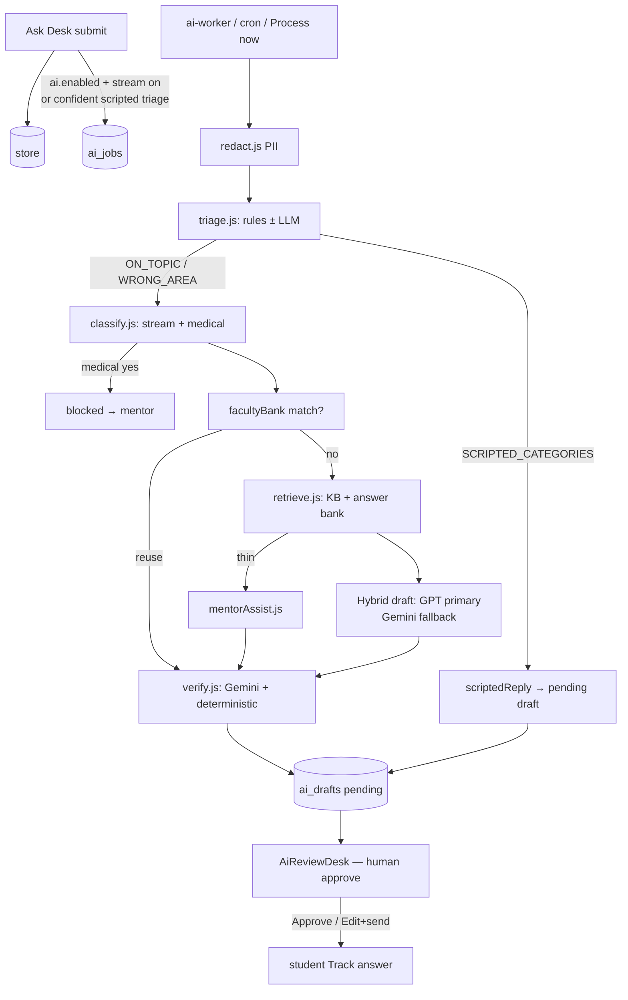

# DISHA V2 — Phase 0 audit (read-only)

**Status:** Phase 0 complete — **owner approved 2026-11-19; Phase 1 shipped** (see `docs/ai/DISHA-V2.md`)  
**Date:** 2026-11-19  
**Scope:** Read-only code/docs/tests audit. No product behaviour changed in this phase.  
**Incident:** Student question *“how can I develop my own application”* / context *“I don't know anything about coding”* (Tech, AI & Digital Health) was marked **Off-topic** with reason *Not about an Ayurveda/AYUSH career ("coding")* at **90% confidence**, tagged **Internship**, and given a **scripted rephrase / scope-decline** reply.

---

## 1. Executive summary — coding false-off-topic bug path

```
Student submits (Tech track)
  → redact PII (server/ai/redact.js)
  → rulesTriage (shared/triageRules.js)
       HISTORICAL: OFF_TOPIC regex matched keyword "coding"
                   → category OFF_TOPIC, confidence 0.9
                   → reason: Not about an Ayurveda / AYUSH career ("coding")
  → SCRIPTED_CATEGORIES → scriptedReply OFF_TOPIC template
       (asks student to rephrase / pick a career question)
  → desk shows RiskBadge with triage.confidence × 100 = "90% confidence"
  → stream label often "Internship" when Tech theme does not resolve
       to a product-track persona (fallback DEFAULT_STREAM)
  → official may Approve → student sees scripted decline (not a real answer)
```

**Root cause (historical):** `OFF_TOPIC` was a broad keyword list that included bare terms such as `coding`, `programming`, `python`, `javascript`, `html`, `css`, `leetcode`. The phrase *“don't know anything about coding”* matched **`coding`**, produced a high fixed confidence (**0.9** when career signal was weak), and short-circuited into a scripted decline — even on the Tech / digital track.

**Mitigation already present in the working tree (Nov 18 skill-learning patch — not Phase 1):**

| Change | Where |
|---|---|
| Split homework dumps from skill asks | `HOMEWORK_DUMP` vs `SKILL_LEARNING` in `shared/triageRules.js` |
| Genuine skill asks → `ON_TOPIC` / `skill-learning` @ 0.9 | `rulesTriage` step 2 |
| `coding` / app terms added to `CAREER_WORDS` + T04 cues | same file |
| Triage LLM system prompt allows skill / app questions | `server/ai/triage.js` `TRIAGE_SYSTEM` |
| Mentor-assist learning homepages + skill template | `server/ai/mentorAssist.js` |
| Tests for the exact incident wording | `tests/ai/triage.test.mjs`, `tests/ai/mentor-assist.test.mjs` |
| Redraft path for wrongly declined scripted drafts | `server/ai/backfill.js` `redraftScripted`, `scripts/ai/enable-pilot.mjs --redraft-scripted` |

**Local reproduce (current tree):** the incident wording is now `ON_TOPIC` / `skill-learning` @ 0.9, and with the live persona registry routes to **entrepreneurship** (app-building cue), not off-topic. Phase 1 is still required: the owner’s “welcome by default” policy, LLM router, fake-confidence replacement, track-as-hint, and removal of scripted off-topic as default are **not** implemented.

---

## 2. Findings (file / line cites)

### 2.1 Rules / classifier that produced the off-topic verdict

| Piece | Location | Notes |
|---|---|---|
| Deterministic triage entry | `shared/triageRules.js` `rulesTriage` ~L544–667 | Rules run first; high confidence skips LLM |
| Historical OFF_TOPIC keywords | Was: one regex including `coding\|programming\|python\|…` (replaced Nov 18) | Match text `"coding"` → reason template below |
| Current OFF_TOPIC / homework | L341–352 (`HOMEWORK_DUMP`), L347–352 (`OFF_TOPIC`), L604–614 | Homework dumps still OFF_TOPIC @ 0.9; skill asks short-circuit ON_TOPIC @ L610–612 |
| Reason string shape | L608, L614, L631 | ``Not about an Ayurveda / AYUSH career ("${match}")`` — exact incident wording |
| Fixed rule confidence | L608 / L614 | `0.9` when `career === 0` (or homework); **not measured**, assigned |
| Rules trust threshold | L31–32 `RULES_SURE = 0.85` | ≥ 0.85 → no LLM second opinion (`server/ai/triage.js` L167–169) |
| LLM triage (only when unsure) | `server/ai/triage.js` `TRIAGE_SYSTEM` L46–60, `llmTriage` L81–106, `combineTriage` L109–151 | LLM may self-report confidence 0–1; merged with `Math.max(rules, llm)` on agree (L132) |
| Medical screen (parallel) | `server/ai/classify.js` `medicalScreen` L59–79; `shared/triageRules.js` `medicalRisk` L298–322 | Unrelated to coding bug; fail-safe for clinical asks |

**Verdict for the incident:** rules layer alone, keyword `"coding"` inside historical `OFF_TOPIC`, confidence **0.9 ≥ RULES_SURE**, so the LLM classifier never ran.

### 2.2 Scripted off-topic / please-rephrase reply

| Piece | Location |
|---|---|
| Scripted category set | `shared/triageRules.js` L29–30 `SCRIPTED_CATEGORIES` includes `OFF_TOPIC` |
| Template (EN / Hinglish) | `server/ai/triageTemplates.js` L28–40 `T.OFF_TOPIC` — scope decline + “please ask a career question” + `{examples}` |
| Renderer | `server/ai/triageTemplates.js` `scriptedReply` ~L228+ |
| Pipeline branch | `server/ai/triage.js` `triagedDraft` L398–411 → `scriptedResult` L312–367 |
| Desk flag | `server/ai/triage.js` L31 `SCRIPTED_FLAG`; L361 `verifyFlags` |
| Ask Desk soft hint (non-blocking) | `shared/triageRules.js` `askDeskHint` L669–686; UI `src/AskTriageHint.jsx` L50–51 |
| Spec | `docs/ai/QUESTION-TRIAGE-SPEC.md` §2 OFF_TOPIC / UNFOCUSED |

UNFOCUSED templates (`triageTemplates.js` L42–54) are the explicit “ask student to rephrase / add detail” path; OFF_TOPIC is a scope decline that also steers toward example career questions.

### 2.3 “Needs triage” and stream / “Internship” tagging

| Piece | Location | Behaviour |
|---|---|---|
| `needsHumanTriage` | `server/ai/triage.js` `combineTriage` L120–150 | Set when rules unsure, rules/LLM disagree, or weak LLM restrict |
| Desk chip / filter | `src/staff/TriagePanel.jsx` L33, L47, L73, L147 | Filter **“Needs triage”**; outline chip when flag true |
| Incident note | Incident showed **90% confidence** from rules, so `needsHumanTriage` was likely **false** (rules “sure”). The chip may still appear on other borderline cases. |
| Stream ids + default | `server/ai/personas/index.js` L68–72 `internship-early-career`, L72 `DEFAULT_STREAM` | Fallback when theme/subtheme do not resolve |
| Persona pick | `personas/index.js` `personaFor` L138–158; Tech alias L83–88 | Tech → Entrepreneurship; Health-tech → Product & prototype |
| App-building cue → entrepreneurship | `personas/index.js` CUES L123 | Present now; may have been absent or unused when stream fell through |
| Classify stream | `server/ai/classify.js` `classifyQuestion` L175–207, `fallbackStreamFor` L117–128 | Unknown theme → **`internship-early-career`** |
| Fallback streams (no aliases) | `classify.js` `FALLBACK_STREAMS` L89–103 | Theme list uses **legacy** names only — **no** `"Tech, AI & Digital Health"` |
| Enqueue stamp | `server/ai/queue.js` L157–173 | `cls.stream` stored on job; desk chip uses stream label |
| Desk short label | `src/staff/AiReviewDesk.jsx` ~L1079–1083 | Shows persona label → **“Internship & early-career…”** reads as **Internship** |

**Why Tech could show Internship:** if the persona registry failed to load, or theme/subtheme aliases were missing at draft time, `fallbackStreamFor("Tech, AI & Digital Health")` does not match any `FALLBACK_STREAMS` theme and returns **`internship-early-career`**. Confident OFF_TOPIC also bypasses per-stream enable via `triageBypassesStreams` (`triage.js` L438–445; `queue.js` L159–160), so the scripted decline still reached the desk under that stream tag.

### 2.4 Risk / confidence % (including fake / self-reported)

| Path | How confidence is set | How risk is set | UI |
|---|---|---|---|
| **Scripted triage (incident)** | `scriptedResult` copies `triage.confidence` (`triage.js` L359) — itself a **hard-coded rule score** (0.9) or LLM self-report | Scripted non-RESTRICTED → `"medium"` (L360) | `AiReviewDesk.jsx` `RiskBadge` L571–576: ``${Math.round(confidence * 100)}% confidence`` |
| **Rules triage** | Fixed literals per branch (`triageRules.js` `result()` L526–536), e.g. OFF_TOPIC 0.9 / 0.75 / 0.55 | N/A until scripted/draft | TriagePanel shows same % (L126–131) |
| **LLM triage** | Model JSON `confidence` 0–1 (`triage.js` `cleanLlm` L69–71) — **self-reported** | — | Merged on agree via `Math.max` (L132) |
| **Grounded draft verify** | `verify.js` `scoreClaims` L314–337: `0.6×support + 0.25×authority + 0.15×retrieval`; capped on unsupported/outdated | high if unsupported / bad citations / no cites; medium if outdated or conf &lt; 0.7 | Same RiskBadge |
| **Mentor-assist** | Cap ≤ 0.4, risk high (`draft.js` / mentor-assist path) | high | Amber “Limited sources” |

**Incident “90% confidence”** = rule constant `0.9`, **not** claim support, **not** calibrated probability. Owner Phase 1 item 6 correctly calls this out for replacement.

### 2.5 Current Hybrid pipeline



| Concern | Source of truth |
|---|---|
| Kill switch | `ai.enabled` (`server/ai/config.js` L7–8, L78); worker stops if false (`queue.js` L476) |
| Spend cap | `ai.dailySpendCapUSD` default **$5** (`config.js` L13); worker pause + desk alert (`queue.js` L506–508) |
| Primary Hybrid | `ai.primary: "hybrid"` — GPT draft + Gemini verify/escalate (`config.js` L17–21; `compare.js` header L1–24; `runtime.js` `hybridProvider` L90+) |
| Rollback | `ai.primary: "gemini"` — Gemini every step |
| Compare mode | `ai.compareMode` default **false** (`config.js` L26); sides `hybrid` \| `gemini` |
| Providers / models | `server/ai/provider.js` PRICES + defaults; Hybrid draft default `gpt-5.4` (`runtime.js` `HYBRID_DEFAULT_DRAFT_MODEL`); verify `AI_VERIFY_MODEL` / Gemini flash |
| Faculty bank | `server/ai/facultyBank.js` (+ `facultyStore.js`, `AI_FACULTY_BANK`); local BM25/Dice/sim match; no API |
| KB retrieval | `server/ai/retrieve.js` — `kb_chunks` / `data/kb/chunks.jsonl`, vector → cosine → BM25; regulator-first for fees/dates |
| PII | `server/ai/redact.js` before any provider call |
| Free-plan / quota defer | `queue.js` `QUOTA_DEFERRED_CODES` L47–48; staff retry after recharge |
| Docs | `docs/ai/AI-ANSWER-PIPELINE.md`, `docs/ai/FACULTY-BANK-SPEC.md`, `docs/ai/KNOWLEDGE-BASE.md` |

### 2.6 Track config source of truth (10 vs 9)

| Layer | File | Count | Role |
|---|---|---|---|
| **Product Ask Desk tracks** | `shared/tracks.js` `TRACKS` L7–127 | **9** (T1–T9) incl. **Tech, AI & Digital Health** (T8) | UI + stored `theme` / `trackCode` |
| Ask Desk wiring | `src/App.jsx` imports `TRACKS` from `shared/tracks.js` | 9 | Form options |
| Triage taxonomy | `shared/triageRules.js` `TRIAGE_THEMES` L13–24 | **10** (T01–T10 legacy names) | Rules + LLM taxonomy |
| Persona themes | `server/ai/personas/index.js` `THEMES` L18–29 | **10** | Stream pairing |
| Aliases product → triage/persona | `triageRules.js` L53–59; `personas/index.js` L83–88 | — | Tech → Entrepreneurship; Academia → Academics; etc. |

**Hard-coded track/theme names in triage:** yes — `TRIAGE_THEMES`, `THEME_ALIASES`, `THEME_EXAMPLES`, cue tables, and `TRIAGE_SYSTEM` embed the 10 legacy theme names. They are **not** read from `shared/tracks.js`. Drift is partially guarded by qbank/persona tests, but **product has 9 tracks while triage/personas still speak 10 legacy themes**. Owner constraint “10 tracks from single config” is **not met** today.

### 2.7 Where selected track gates vs hints today

| Layer | Gate or hint? | Behaviour |
|---|---|---|
| Ask form | Soft gate | Student must pick a track/sub-area to submit (`shared/tracks.js` + Ask UI) |
| `askDeskHint` | Hint only | Never blocks send (`AskTriageHint.jsx`) |
| `rulesTriage` WRONG_AREA | Soft gate → refile draft under suggested theme | Uses picked theme vs cue scores (`triageRules.js` L634–663) |
| Historical OFF_TOPIC keywords | **Hard gate to scripted decline** | Independent of track — coding match declined even on Tech |
| `personaFor` / classify stream | Routing (affects which mentor persona drafts) | Selected theme/subtheme drive stream; mismatch → wrong persona / Internship fallback |
| `streamEnabled(cfg, streamId)` | **Hard gate** on auto-queue | Per-stream Settings toggles (`config.js` L124–128; `queue.js` L160) — except confident scripted triage bypass |
| Phase 1 target | Track = **hint only** | Always answer; set `routedTrack` + friendly banner |

---

## 3. What Phase 1 must change (map to owner’s 12-point plan)

> **Do not implement until approved.** High-level mapping only.

| # | Owner plan | Current gap (from this audit) |
|---|---|---|
| **1** | Scope policy “welcome by default”; track = hint; rules only for spam/abuse/unsafe; remove scripted off-topic/rephrase as default | Skill-learning patch is a narrow exception; `OFF_TOPIC` / `UNFOCUSED` scripted paths + keyword philosophy remain |
| **2** | Cheap LLM router JSON schema; fix Internship tagging; stop showing fake confidence | Rules-first triage + hard-coded confidences; Tech→Internship fallback still possible; stream ≠ product track |
| **3** | Answer writer: step-by-step from zero; golden coding/app example | Mentor-assist + digital persona help, but not the new writer contract / structure |
| **4** | Grounding metadata (tier, jurisdiction, expires); claim FACT/ADVICE; strip bad URLs | Verify exists (`verify.js`) but KB metadata / expiry / jurisdiction incomplete vs plan |
| **5** | Cost/quota: classify→retrieve→draft→verify; compare sample-only | Hybrid + spend cap + compare flag exist; default Hybrid still uses **paid GPT draft** (`gpt-5.4`) |
| **6** | Risk reasons from coverage / unsupported / sensitivity — not self-reported % | Scripted path copies rule/LLM confidence; RiskBadge always shows % |
| **7** | Reviewer UX: why-routed, claims table, confirm on unsupported, reason codes | Desk exists; missing new routing panel / reason taxonomy / confirm dialog |
| **8** | Gold set + `eval:disha` + feedback → faculty bank | Faculty bank + some eval scripts exist; not the V2 gold set / CI gate |
| **9** | Hard safety narrowed to real risks | Medical / restricted lexicons strong; scope policy too broad on career-only OFF_TOPIC |
| **10** | Language + jurisdiction | `detectLanguage` en/hinglish/hi; Odia + jurisdictionHint not first-class |
| **11** | WAC portal adapter (base URL, SSO, CSP) | Outside core AI path; flag for separate track |
| **12** | Config flags: scope version, compare sample rate, `AI_ALLOW_SCRIPTED_OFFTOPIC=false`, kill switch, plan mode | Partial: `enabled`, spend cap, compareMode, primary — not the new flag set |

**Tests Phase 1 must prove:** coding/app in scope → Tech/AI track → step answer; track mismatch still answers; no in-scope rephrase-only reply; PERSONAL_HEALTH / WELLBEING escalate; no invented URLs; PII redaction; spend cap + kill switch.

---

## 4. Decision ask — Hybrid cost (Gemini paid + free/cheap GPT)

**Owner idea:** keep Hybrid architecture, but use **paid Gemini** as primary verifier (and possibly stronger check) and a **free / free-tier / cheap GPT** (or other cheap model) for drafting.

**Fit vs current Hybrid (`config.js` / `compare.js` / `runtime.js`):** Today Hybrid is the **inverse spend profile** — **paid GPT (`gpt-5.4`) drafts** and **Gemini verifies**. Swapping to **cheap draft + paid Gemini verify** fits the safety design (draft may be imperfect; verifier + human approval are the trust gates) and should cut per-answer $ vs current Hybrid evidence (~$0.03/draft in pipeline docs).

**Risks to accept explicitly:**

1. **Quota risk** — free-tier GPT and free-tier Gemini both 429/day-cap; worker already defers quota (`queue.js`) but congress load can stall the queue. Prefer a **cheap paid nano/mini draft** over true $0 free if reliability matters.
2. **Quality risk** — weaker drafter → more mentor-assist / more staff edits; keep spend cap, kill switch, and sample a % of questions with a stronger draft model for eval (`ai.compareMode` or new `AI_COMPARE_SAMPLE_RATE`).
3. **Implementation (Phase 1+, not now):** env/Settings for draft model id; keep Gemini on verify/escalate/classify; document fallback when free draft key is exhausted (already: Gemini draft fallback in `hybridProvider`).

**Recommendation for owner approval:** Yes — keep Hybrid shape; set draft to a **cheap GPT-class model** (or free-tier with clear quota ops) and keep **paid Gemini on verify**; turn compare mode off except sampled eval. Do **not** flip production models until Phase 1 scope/router work is approved and a small dry-run eval is reviewed.

---

## 5. Constraints checklist (master prompt — still in force)

| Constraint | Current support |
|---|---|
| Human approval before students see answers | Yes — desk approve/edit (`ops.js`, AiReviewDesk) |
| PII redaction before LLM | Yes — `redact.js` |
| Spend cap + kill switch | Yes — `dailySpendCapUSD`, `enabled` |
| Free-plan quotas | Partial — quota defer + alerts; KB/Firestore still careful |
| No fixed deadline dates in product copy | Process constraint (not re-audited here) |
| Tracks from single config | **Gap** — 9 in `tracks.js` vs 10 triage/persona themes + aliases |
| Never print/commit secrets | Process |
| Emulator/staging only for this phase | Honoured — Phase 0 wrote docs only |

---

## 6. STOP / await approval gate

```
████████████████████████████████████████████████████████████
█  PHASE 0 COMPLETE — NO PHASE 1 IMPLEMENTATION            █
█  Awaiting owner approval of:                             █
█    • this audit                                          █
█    • Phase 1 12-point scope                              █
█    • Hybrid cost decision (cheap GPT draft + paid Gemini)█
█  Do not change product behaviour until explicitly told.  █
████████████████████████████████████████████████████████████
```

**Next (only after approval):** implement Phase 1 per §3; ship `docs/ai/DISHA-V2.md`, gold set, eval harness, reviewer UX updates; report eval numbers and open decisions.

---

## Appendix — key file index

| Area | Paths |
|---|---|
| Triage rules | `shared/triageRules.js` |
| Tracks | `shared/tracks.js` |
| Triage pipeline / templates | `server/ai/triage.js`, `triageTemplates.js`, `triageOps.js` |
| Classify / streams | `server/ai/classify.js`, `personas/index.js` |
| Draft / verify / retrieve | `draft.js`, `verify.js`, `retrieve.js`, `mentorAssist.js` |
| Hybrid / config / queue | `compare.js`, `config.js`, `runtime.js`, `queue.js`, `ops.js` |
| Faculty | `facultyBank.js`, `docs/ai/FACULTY-BANK-SPEC.md` |
| Desk UI | `src/staff/AiReviewDesk.jsx`, `TriagePanel.jsx`, `src/AskTriageHint.jsx` |
| Specs | `docs/ai/AI-ANSWER-PIPELINE.md`, `QUESTION-TRIAGE-SPEC.md` |
| Regression tests | `tests/ai/triage.test.mjs`, `mentor-assist.test.mjs`, `pipeline.test.mjs` |
