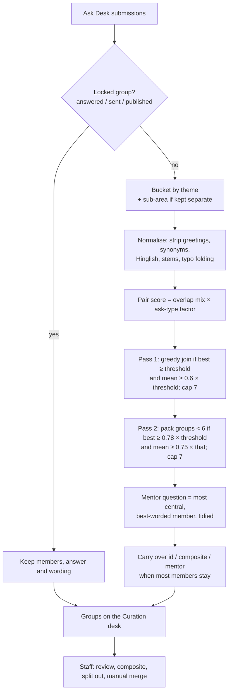

# AYURDISHA merge engine — how it works, accuracy at 1,200 questions, recommended settings

## Update 25 Oct 2026 — precision-first engine (current)

The engine now merges two questions automatically **only when they ask the same thing about the same subject**, so one mentor answer fully serves every student in the group. Spec, error taxonomy and acceptance results: [PRECISION-FIRST-SPEC.md](PRECISION-FIRST-SPEC.md). Sections 4–5 below describe the previous engine; where they disagree, this section wins.

**Results on data never used for tuning** (threshold 0.48, sub-areas kept / mixed):

| set | engine | wrong-answer students | AUTO pair precision | AUTO recall | AUTO + accepted suggestions recall |
|---|---|---|---|---|---|
| B held-out (163) | live before (H) | 0.6% / 1.2% | 0.981 / 0.967 | 0.167 / 0.186 | — |
| | precision-first | **0.0% / 0.0%** | **1.000 / 1.000** | 0.123 / 0.126 | 0.277 / 0.305 |
| NEW-2 (499, frozen before final fixes) | live before (H) | 1.6% / 3.2% | 0.923 / 0.906 | 0.284 / 0.381 | — |
| | precision-first | **0.2% / 0.2%** | **0.995 / 0.996** | 0.219 / 0.266 | 0.490 / 0.472 |

The cost is recall: fewer students are merged automatically (NEW-2: 40% vs 47.5% of students); the near misses wait for staff in *Suggested merges*, and accepting them recovers more than the old engine merged.

### Staff guide — the three tiers

| what you see | meaning | what to do |
|---|---|---|
| Group card, **High confidence** (green) | Same subject, same ask, every pair strongly similar. | Write the composite and send. Spot-check only. |
| Group card, **Good match** (tan) | Same subject and ask; at least one pair is worded quite differently. | Read the student wording before sending. |
| Group card, **Check this group** (gold, with reason) | Usually a manual merge or an old group whose members differ (e.g. *different countries*, or one asks something else). | Open it; **Split out** anyone the composite cannot fully answer. |
| **Suggested merges** panel (§02) | Two groups that look like the same ask but missed one automatic rule — reason shown (*filed under different sub-areas*, *one also mentions PhD*, *one asks something more specific*, *worded differently*). Never merged until you decide. | **Merge** if one answer serves both (refused automatically if it would exceed 7 students or touch a locked group). **Keep apart** if not — the decision is saved with the groups and survives every re-merge. |
| Not shown anywhere | Low tier: clashing asks (cost vs licence), conflicting specifics (UK vs Germany, AIAPGET vs NEET-PG, MD Shalya vs MD Kayachikitsa, 6 months vs 1 year, with vs without PG), or no shared subject. | Nothing — these never merge. Use the filter + manual merge if you disagree. |

Event-day rhythm: **Re-merge** every 30–60 minutes → clear *Suggested merges* top-down (they are sorted by similarity; the top ones are usually duplicates filed under a neighbouring sub-area) → review *Check this group* cards → write composites. Answered, sent-to-mentor and published groups never change on re-merge. "Why merged" on each card lists the shared subject, the shared ask and the weakest / average pair score.

---

> **Update (24 Oct 2026, later):** after a head-to-head with the candidate engine, the live engine gained the candidate's domain vocabulary (minus 5 items that misfired). Algorithm, gates and defaults are unchanged. See [ENGINE-COMPARISON.md](ENGINE-COMPARISON.md) for the method, tables and current numbers.

*24 Oct 2026 · engine: `shared/merge.js` (used by the Curation desk in the browser and by the server's manual merge / integrity checks) · deployed to https://ayushmarg.vercel.app*

---

## 1. How merging works (plain language)

1. **Questions are only ever compared inside the same theme.** With *Keep sub-areas separate* on (the default), also only inside the same sub-area. Two students who picked different themes are never merged automatically — not at any slider position.
2. **Each question is reduced to its topic words.** Lower-case, accents removed; greetings, self-introductions and sign-offs dropped ("Sir,", "I am a final year BAMS student.", "Please guide."); filler and Hinglish function words removed ("what", "please", "kya", "kaise", "ke baad"); spellings folded onto one word — MD/MS/post-graduation → **PG**, AIAPGET/apget/AI-APGET → **AIAPGET** (+ PG + exam), panchkarma/Pancha Karma → **panchakarma**, govt/sarkari → **government**, naukri/vacancy → **job**, centre/center, open/set up/kholne/shuru → **start**, and so on; simple stemming (preparing/preparation → prepare); typos one letter away from a known word fold ("patetn" → patent, "aiaget" → AIAPGET, "traning" → training).
3. **Two questions get a similarity score from 0 to 1:**
   `score = (0.55 × weighted word overlap + 0.35 × plain word overlap + 0.10 × word-pair overlap) × ask-type factor`
   - *Weighted overlap*: rare words in the group count 1.5×; words only in the optional "context" box count 0.5×.
   - *Ask-type factor*: if both questions name a specific ask and they differ (licence vs cost, books vs cut-off, USA vs UK, salary vs eligibility, patients vs licence…) the score is ×0.6; if only one names one, ×0.85. Same wording → always 1.
4. **Grouping is greedy and deterministic.** Questions are visited from most to fewest topic words (then by time, then id). Each joins the existing group it is closest to if it scores ≥ the threshold with at least one member *and* its average with the whole group is ≥ 60 % of the threshold (stops "chains" A~B~C pulling unrelated A and C together). Otherwise it starts its own group.
5. **Small groups are then packed.** Groups of fewer than 6 combine with another group when their best pair reaches max(0.28, 0.78 × threshold) and their average reaches 75 % of that. This fills mentor tables without dropping to unrelated questions.
6. **No group ever exceeds 7** (one mentor table). When a topic has 30 askers it becomes several packs of ≤ 7 — overflow simply opens a new pack; nobody is dropped or duplicated.
7. **Every group gets one "question for the mentor".** Among the members that are most central (average similarity to the rest within 0.1 of the best), the cleanest-worded one wins — English over Hinglish/Devanagari, no greeting, no typo, not ALL CAPS, sensible length, ends with "?". It is tidied (greeting and "??" removed, first letter capitalised; words are never rewritten) and stored as `representative` (+ `representativeId`). Staff can overwrite it with a hand-written **composite** — the composite, when present, is what the mentor sheet and Track page show.
8. **Re-merge is safe.** Groups that are answered, sent to a mentor or published are *locked*: they keep their students, answer and wording; new look-alike questions never slip into them. Other groups keep their id, composite and mentor when most of their students stay together. Running re-merge twice gives the same result; input order does not matter.
9. **Staff overrides.** *Merge selected groups* (server, version-locked, refuses two different answers, flags mixed themes) and *Split out* (one student → own group, loses the group answer) work on top; a save that would put a student in two groups is repaired server-side, and a stale save is rejected with 409.



---

## 2. Worked example (real output, `node scripts/merge-demo.mjs`)

14 questions across T02 Academics (PG), T01 Clinical (Panchakarma, private practice) and T10 Policy (government). Threshold 0.48, sub-areas kept separate.

**Tokens** (what the engine actually compares):

```
q01 [T02 · Choosing a PG branch]  "What should I do after BAMS — PG or practice?"           → {pg, practice}
q02 [T02 · Choosing a PG branch]  "Is MD Ayurveda better than starting a clinic?"           → {pg, start, clinic}
q03 [T02 · Choosing a PG branch]  "How to prepare for AIAPGET?"                             → {prepare, aiapget, pg, exam}
q04 [T02 · Choosing a PG branch]  "Best books for AIAPGET preparation?"                     → {book, aiapget, pg, exam, prepare}
q05 [T02 · Choosing a PG branch]  "BAMS ke baad AIAPGET ki taiyari kaise kare?"             → {aiapget, pg, exam, prepare}
q06 [T02 · Choosing a PG branch]  "How should I prepare for the PG entrance exam during internship?" → {prepare, pg, exam, dur, internship}
q07 [T02 · Choosing a PG branch]  "aiapget prepration startegy for final year"              → {aiapget, pg, exam, prepare, startegy}
q08 [T01 · Panchakarma & therapy services]  "How to start a Panchakarma centre?"            → {start, panchakarma, centre}
q09 [T01 · Panchakarma & therapy services]  "How can I open my own panchkarma center after BAMS?" → {start, panchakarma, centre}
q10 [T01 · Panchakarma & therapy services]  "Is a separate certificate needed to run Panchakarma therapy?" → {separat, certificat, run, panchakarma, therapy}
q11 [T10 · Government service routes]  "Govt job options after BAMS?"                       → {government, job}
q12 [T10 · Government service routes]  "What sarkari naukri can I get after BAMS?"           → {government, job}
q13 [T10 · Government service routes]  "How to prepare for state PSC Ayurveda medical officer exam?" → {prepare, stat, psc, medicalofficer, exam}
q14 [T01 · Setting up private practice]  "Which licence is required to start a clinic?"     → {licence, requir, start, clinic}
```

**Key pair scores** (✔ = clears 0.48):

```
q03–q05  0.950 ✔   AIAPGET prep, English vs Hinglish
q05–q07  0.795 ✔   Hinglish vs typo'd "prepration"
q03–q07  0.760 ✔
q04–q05  0.676 ✔   books vs prep (same family — see note)
q03–q04  0.646 ✔
q04–q07  0.561 ✔
q03–q06  0.467     "PG entrance exam during internship" — just under; joins in the packing pass
q06–q07  0.400
q08–q09  1.000 ✔   centre / center, open / start, panchkarma — identical after normalising
q11–q12  1.000 ✔   govt job ≡ sarkari naukri
q01–q02  0.225     "PG or practice?" vs "MD better than a clinic?" — missed (practice ≠ clinic)
q08–q10  0.129     start a centre vs certificate — correctly apart
```

**Groups and the single question each group's mentor answers:**

```
G03 · MERGED · 5 students · T02 / Choosing a PG branch · cohesion 0.30 · merged on: exam, PG, prepare, AIAPGET
  QUESTION FOR THE MENTOR → "How to prepare for AIAPGET?"
    - q04: Best books for AIAPGET preparation?
    - q07: aiapget prepration startegy for final year
    - q03: How to prepare for AIAPGET?
    - q05: BAMS ke baad AIAPGET ki taiyari kaise kare?
    - q06: How should I prepare for the PG entrance exam during internship?

G05 · MERGED · 2 students · T01 / Panchakarma & therapy services · cohesion 1.00 · merged on: centre, panchakarma, start
  QUESTION FOR THE MENTOR → "How to start a Panchakarma centre?"
    - q08 / q09

G08 · MERGED · 2 students · T10 / Government service routes · cohesion 1.00 · merged on: government, job
  QUESTION FOR THE MENTOR → "Govt job options after BAMS?"
    - q11 / q12

Singles (each still gets its own mentor answer):
  G01 "What should I do after BAMS — PG or practice?"
  G02 "Is MD Ayurveda better than starting a clinic?"
  G04 "Is a separate certificate needed to run Panchakarma therapy?"
  G06 "Which licence is required to start a clinic?"
  G07 "How to prepare for state PSC Ayurveda medical officer exam?"

14 questions → 8 groups (3 merged, 5 single). Lost: 0, duplicated: 0.
```

**Before the fixes** the same input produced the same membership but the AIAPGET group's mentor question was the longest text, *"How should I prepare for the PG entrance exam during internship?"*, the Panchakarma pair scored only 0.483 (centre ≠ center) and its question was the typo'd *"How can I open my own panchkarma center after BAMS?"*.

**What staff should do with this desk:** write a composite for G03 such as *"How should I prepare for AIAPGET — strategy, timetable during internship, and which books?"* (covers q04's books ask), and manually merge G01 + G02 ("PG or own practice first?") — the engine deliberately does not equate *practice* with *clinic*.

---

## 3. Accuracy test at scale

**Dataset** — `tests/fixtures/merge-1200.json`, generated by `node scripts/merge-bench/generate.mjs 1200 2026` (seeded, deterministic) from `scripts/merge-bench/intents.mjs`:
- 1,200 questions, **84 intents** across all 10 themes + "Not sure", plus **32 one-off questions** that should stay single. Popularity is skewed like a real hall (AIAPGET prep 82 askers, govt jobs 61, PG-or-practice 54 … long tail of 2–5).
- Each intent has 2–9 templates with slot variants (PG/MD/MD-MS/post graduation/masters; AIAPGET/PG entrance/AI-APGET; clinic/dispensary/practice; Panchakarma spellings; govt/sarkari; job/naukri/vacancies; start/open/set up/establish; abroad/outside India/overseas), Hinglish and Devanagari forms.
- Noise: 30 % greeting/self-intro prefixes, 22 % sign-offs, ~23 % with a typo, 28 % lower-case, 3 % ALL CAPS, 15 % punctuation stripped, 40 % with a context line (some contain topic words like "PG", "clinic", "abroad").
- Students mis-file: 80 % pick the intent's home sub-area, 12 % a plausible alternative, 5 % another sub-area of the same theme, 3 % another theme (**8.9 % of questions sit outside their intent's home theme — those can never be auto-merged by design**).
- Distractor intents that share words but need different answers: AIAPGET prep / books / cut-off; clinic licence / cost / first patients / location; PG branch / PG-or-practice / is-PG-worth-it; hospital job / salary; Panchakarma centre / training / staff; countries / USA / UK / licence abroad; faculty eligibility / salary; govt jobs / PSC exam / UPSC; etc. Each intent also carries a *family* (answers overlap) for a lenient precision.

**Metrics** (`node scripts/merge-bench/run.mjs`; pairs = two students in one group):
- **precision** — co-grouped pairs that share an intent. **soft-prec** — share an intent family.
- **recall** — same-intent co-grouped pairs ÷ the best any grouping could reach *within one theme with packs ≤ 7* (2,758 pairs).
- **F0.5** — precision weighted twice recall.
- **wrong-answer** — % of all students whose intent differs from their group's mentor question (in brackets: different *family*, i.e. an unrelated answer).

### Before → after (same fixture)

| sub-areas | thr | engine | groups | singles | merged | precision | recall | F0.5 | wrong-answer |
|---|---|---|---|---|---|---|---|---|---|
| kept | 0.42 | before | 564 | 337 | 71.9% | 0.893 | 0.522 | 0.782 | 5.7% (2.9%) |
| kept | 0.42 | after | 521 | 284 | 76.3% | 0.923 | 0.580 | 0.825 | 3.3% (1.8%) |
| kept | 0.46 | before | 587 | 358 | 70.2% | 0.900 | 0.495 | 0.774 | 5.0% (2.3%) |
| kept | 0.46 | after | 544 | 303 | 74.8% | 0.964 | 0.570 | 0.847 | 2.2% (1.5%) |
| **kept** | **0.48** | before | 600 | 374 | 68.8% | 0.921 | 0.485 | 0.781 | 4.3% (2.1%) |
| **kept** | **0.48** | **after** | **550** | **311** | **74.1%** | **0.960** | **0.559** | **0.839** | **1.8% (0.8%)** |
| kept | 0.50 | before | 611 | 389 | 67.6% | 0.921 | 0.474 | 0.775 | 3.9% (2.2%) |
| kept | 0.50 | after | 558 | 318 | 73.5% | 0.972 | 0.551 | 0.843 | 1.0% (0.7%) |
| mixed | 0.42 | before | 435 | 193 | 83.9% | 0.863 | 0.639 | 0.807 | 7.7% (3.8%) |
| mixed | 0.42 | after | 417 | 170 | 85.8% | 0.926 | 0.703 | 0.871 | 3.8% (3.0%) |
| mixed | 0.48 | before | 480 | 230 | 80.8% | 0.904 | 0.597 | 0.820 | 5.0% (2.4%) |
| mixed | 0.48 | after | 446 | 186 | 84.5% | 0.958 | 0.673 | 0.883 | 1.7% (1.4%) |

Mentor question wording at the default: **before** 130 of 227 merged groups showed a greeting / self-intro ("Sir, I am a final year…") and 20 were Hinglish/Devanagari; **after** 2 of 239 and 13 (only when every member is Hinglish).

### Full sweep after the fixes (0.30 → 0.60)

| sub-areas | thr | groups | singles | merged | avg merged size | precision | soft-prec | recall | F1 | F0.5 | wrong-answer |
|---|---|---|---|---|---|---|---|---|---|---|---|
| kept | 0.30 | 486 | 256 | 78.7% | 4.10 | 0.857 | 0.935 | 0.596 | 0.703 | 0.788 | 6.1% (2.8%) |
| kept | 0.34 | 491 | 257 | 78.6% | 4.03 | 0.888 | 0.943 | 0.599 | 0.715 | 0.810 | 4.7% (2.5%) |
| kept | 0.38 | 503 | 270 | 77.5% | 3.99 | 0.905 | 0.944 | 0.601 | 0.722 | 0.822 | 4.2% (2.7%) |
| kept | 0.42 | 521 | 284 | 76.3% | 3.86 | 0.923 | 0.967 | 0.580 | 0.712 | 0.825 | 3.3% (1.8%) |
| kept | 0.44 | 533 | 295 | 75.4% | 3.80 | 0.945 | 0.969 | 0.583 | 0.721 | 0.841 | 2.5% (1.7%) |
| kept | 0.46 | 544 | 303 | 74.8% | 3.72 | 0.964 | 0.973 | 0.570 | 0.716 | 0.847 | 2.2% (1.5%) |
| kept | **0.48** | 550 | 311 | 74.1% | 3.72 | 0.960 | 0.976 | 0.559 | 0.707 | 0.839 | 1.8% (0.8%) |
| kept | 0.50 | 558 | 318 | 73.5% | 3.67 | 0.972 | 0.982 | 0.551 | 0.704 | 0.843 | 1.0% (0.7%) |
| kept | 0.54 | 577 | 340 | 71.7% | 3.63 | 0.975 | 0.981 | 0.529 | 0.686 | 0.834 | 0.8% (0.7%) |
| kept | 0.60 | 604 | 366 | 69.5% | 3.50 | 0.989 | 0.989 | 0.486 | 0.652 | 0.819 | 0.3% (0.3%) |
| mixed | 0.30 | 378 | 146 | 87.8% | 4.54 | 0.765 | 0.856 | 0.650 | 0.702 | 0.738 | 12.6% (7.7%) |
| mixed | 0.38 | 393 | 149 | 87.6% | 4.31 | 0.862 | 0.917 | 0.693 | 0.768 | 0.822 | 6.8% (4.3%) |
| mixed | 0.42 | 417 | 170 | 85.8% | 4.17 | 0.926 | 0.946 | 0.703 | 0.799 | 0.871 | 3.8% (3.0%) |
| mixed | 0.46 | 437 | 178 | 85.2% | 3.95 | 0.949 | 0.957 | 0.683 | 0.795 | 0.881 | 2.5% (2.3%) |
| mixed | 0.48 | 446 | 186 | 84.5% | 3.90 | 0.958 | 0.966 | 0.673 | 0.791 | 0.883 | 1.7% (1.4%) |
| mixed | 0.50 | 452 | 191 | 84.1% | 3.87 | 0.957 | 0.969 | 0.657 | 0.779 | 0.877 | 1.8% (1.3%) |
| mixed | 0.56 | 476 | 216 | 82.0% | 3.78 | 0.981 | 0.981 | 0.633 | 0.770 | 0.884 | 0.8% (0.8%) |
| mixed | 0.60 | 497 | 233 | 80.6% | 3.66 | 0.989 | 0.989 | 0.595 | 0.743 | 0.873 | 0.4% (0.4%) |

(Every threshold 0.30–0.60 in 0.02 steps is in `docs/merge/bench-after.json`; the baseline in `docs/merge/bench-baseline.json`.)

**Always true, at every threshold, both sub-area modes, before and after:** 0 cross-theme merges · 0 groups over 7 · 0 questions lost · 0 duplicated · 0 orphaned ids.

**Operational checks at 1,200 (after):**
- Runtime: **38 ms** for one full merge of 1,200 questions (developer laptop) — 80 ms worst case with sub-areas mixed. No performance concern at 1,000–5,000 questions.
- Re-merge twice → identical ids and members. Reversed input order → identical groups.
- Event flow: merge 1,000, mark every third group answered/published, add 200 more, re-merge → every answered group kept its members and answer, no answer copied to a new group, 0 lost, 0 duplicated.

**Cross-check on an independent corpus.** A separate hand-written benchmark exists in the repo (`tests/fixtures/merge-benchmark.json`, 539 questions / 113 intents with a held-out test split, `npm run bench:merge`). It was not used to tune these changes. On its held-out split with sub-areas kept: at 0.475, precision 0.860 → **0.978**, recall (cap-adjusted) 0.118 → 0.140, wrong-answer 2.5 % → **0.6 %**; at 0.50, precision 0.875 → 1.000, wrong-answer 2.5 % → 0.0 %. Its dev split improves too (0.475: P 0.711 → 0.822, wrong-answer 3.5 % → 2.4 %). That corpus is deliberately harder (paraphrases that share few words), so absolute recall is low for any word-overlap engine; the direction of every change agrees with the 1,200 test. On that corpus mixing sub-areas *hurts* precision, which is why keeping them separate stays the default.

---

## 4. Recommended settings for a 1,000+ question event

| Setting | Value | Why |
|---|---|---|
| **Threshold ("Word overlap needed to merge")** | **0.48** (new default) | On both benchmarks the student-facing wrong-answer rate keeps falling up to ~0.50 while recall barely moves after 0.46. At 0.48 with sub-areas kept: precision 0.96, 74 % of students share a mentor answer, 1.8 % of students (≈ 22 of 1,200) sit under a different question — of whom fewer than half get an unrelated answer (0.8 %). Old default 0.42 on the old engine: 5.7 % (≈ 68 students). |
| Keep sub-areas separate | **On** | Safer: the independent corpus loses precision when sub-areas mix. Turn it **off for a final sweep of "Not sure" and low-volume themes** only, then review those groups (on the 1,200 test, mixing at 0.48 lifts recall 0.56 → 0.67 at the same 1.7 % wrong-answer rate, because ~11 % of students file under a neighbouring sub-area of the right theme). |
| Pack cap | 7 (unchanged) | One mentor table. At 1,200 questions it yields ~550 groups ≈ 24 answers per mentor for 23 mentors; most of those are singles that can be answered briefly or batched by theme. |
| Range to use | 0.46–0.52 | Below 0.44 wrong merges climb quickly (0.30 → 6 % with sub-areas kept, 12.6 % mixed). Above 0.54 merging falls off without much precision left to gain. |

**Why precision over recall:** a missed merge costs a mentor one extra short answer; a wrong merge sends a student an answer to someone else's question on *Track my answer*. F0.5 (precision-weighted) peaks at 0.46 and stays within 1 % up to 0.52; 0.48 sits on the safe side of that peak with clearly fewer wrong answers.

---

## 5. Staff operating guide (event day)

1. **Merge in waves.** Press *Re-merge* every 30–60 min (or each ~200 new questions). It never breaks up answered / sent / published groups, so the desk can work while questions keep arriving.
2. **Review the risky groups first.** Each merged card shows *Merged on: …* and *closest-pair floor*. Open every group whose floor is **below 0.30** or whose "merged on" words are only generic (PG, exam, job, start). These are where packing combined two near topics.
3. **Read the student wording, not just the headline.** If one student asks something different (books vs strategy, cost vs licence, USA vs UK), press **Split out** on that student — they get their own row and keep their own answer path.
4. **Write the composite before sending to a mentor.** One question that fairly covers every member (e.g. fold the books ask into the AIAPGET-prep composite). Once a group is *Sent to mentor*, its membership and wording are frozen on re-merge.
5. **Manually merge obvious misses.** Use the filter box (e.g. "AIAPGET", "clinic", "abroad") to find singles and small groups on the same ask — especially *PG vs own practice* wording ("practice" vs "clinic"), Hinglish-only questions, and students who filed under a neighbouring sub-area. Tick and *Merge selected groups*.
6. **Not sure — help me classify** is its own theme: sweep it once with sub-areas mixed and either merge it into the right theme's group manually or answer it as a group of generic "what after BAMS?" questions.
7. **Two staff at once:** a stale save is rejected with *Reload latest*. Reload, then redo the last change — nothing is lost on the server.

Known remaining weak spots (from `node scripts/merge-bench/diagnose.mjs`, ~1–2 % of students): PG-branch vs PG-or-practice, generic "recognised abroad" vs a specific country, AIAPGET books/cut-off folded into AIAPGET prep (same family — a good composite fixes it), research-topic vs start-research. All are visible and fixable with *Split out*.

---

## 6. Changes made (all in `shared/merge.js`, deterministic)

| Change | Defect / win it addresses |
|---|---|
| **Mentor question = most central, best-worded member, tidied** (`pickRepresentative`, `wordingQuality`, `tidyQuestion`; new `representativeId`) | Was "longest text", which picked the noisiest wording (greeting + self-intro + sign-off) in 57 % of groups and sometimes an off-topic member. |
| Answered / sent-out (locked) groups keep their stored wording on re-merge | New representative logic must not change what students already saw. |
| Manual merge without a question lookup (server) keeps the anchor group's mentor question instead of the longest one | Same reason as above. |
| **Greeting / self-intro / sign-off stripping** (`stripBoilerplate`) + filler words (final, year, doctor, graduate, help, advise, better, completing…) | "I am a final year BAMS student." made unrelated questions share three words. |
| **B.A.M.S. phrase rule before the M.S. rule** | **Bug:** "B.A.M.S." became an *MS* (= PG) token, so "kya B.A.M.S. ka future accha hai?" merged with PG questions. |
| **Ask-type (facet) damping** ×0.6 / ×0.85 | Largest source of wrong merges: clinic licence × cost × first patients, USA × UK, faculty eligibility × salary, Panchakarma centre × staff. |
| Short-typo folding onto known terms (with a protect list: patient, parent, lecture, …) | "patetn", "aiaget", "sohuld", "opitons", "reocgnised" stayed single. |
| Hindi "after BAMS" fallback (baad → after, बीएएमएस → bams) and filler-free fallback | "bams ke baad kya kare?" and "best options after completing BAMS" never met "What should I do after BAMS?". |
| Synonyms: centre/center, specialty variants, necessary/compulsory/zaroori, textbook → book, kholne/shuru/set up → start, pay → income, money → cost | Gaps seen in the worked example and diagnostics. |
| Packing pass: average-similarity guard 0.6 → **0.75** (`packMean`) | Small groups were combined on one strong pair; tighter guard lifts precision at ~1 pt recall. |
| **Default threshold 0.42 → 0.48** | See §4. The Curation desk slider starts at the new default; staff can still move it 0.15–0.70. |

**Tests:** `tests/merge-accuracy.test.mjs` (9 new) — boilerplate, B.A.M.S., Hindi fallback, typo folding + protection, facet damping, representative choice + tidy, locked wording, and a **1,200-question scale guard** (precision ≥ 0.94, wrong-answer ≤ 2.5 %, ≥ 70 % merged, cap/theme/sub-area integrity, < 2 s). `npm test`: **53 / 53 pass** · `npm run build`: **passes** · deployed to production with `npx vercel --prod --yes` (live bundle verified; no Firestore data touched).

**Scripts:**
- `node scripts/merge-demo.mjs [--engine path]` — the worked example above.
- `node scripts/merge-bench/generate.mjs [count] [seed]` — rebuild the labelled fixture.
- `node scripts/merge-bench/run.mjs [--engine path] [--label name] [--opts '{"packMean":0.6}']` — sweep table + operational checks → `docs/merge/bench-<label>.json`.
- `node scripts/merge-bench/diagnose.mjs [--t 0.48] [--sub on|off]` — top wrong merges and most-fragmented intents.

**Limits of this test:** the 1,200 questions are synthetic (templated paraphrases + realistic noise), so absolute recall on real hall questions will be lower where students phrase the same need in completely different words; the independent hand-written corpus shows that. Precision and integrity results are the reliable part. Re-run `run.mjs` on an anonymised export of real Ask Desk questions after day one if labels can be added.
